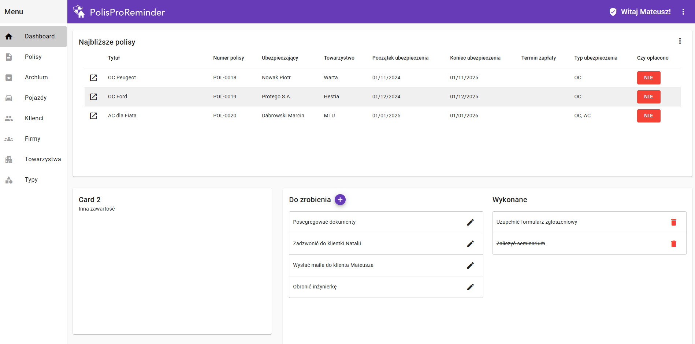
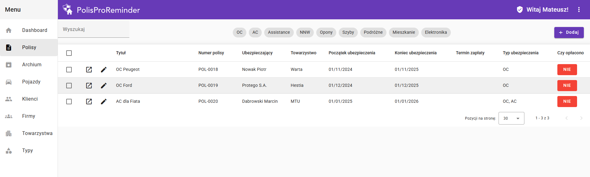

# PolisProReminder

PolisProReminder to aplikacja webowa stworzona w celu ułatwienia zarządzania polisami ubezpieczeniowymi. Umożliwia agentom ubezpieczeniowym oraz ich asystentom śledzenie terminów, płatności i szczegółów polis, a także zarządzanie informacjami o klientach, pojazdach i towarzystwach ubezpieczeniowych.

## Główne Funkcjonalności

- **Zarządzanie Polisami:** Dodawanie, edytowanie, usuwanie i archiwizowanie polis ubezpieczeniowych.
- **Zarządzanie Klientami:** Prowadzenie bazy klientów indywidualnych oraz biznesowych.
- **Zarządzanie Pojazdami:** Ewidencja pojazdów z możliwością przypisania do klienta.
- **Zarządzanie Towarzystwami Ubezpieczeniowymi:** Baza towarzystw ubezpieczeniowych.
- **Zarządzanie Typami Ubezpieczeń:** Definiowanie różnych typów ubezpieczeń.
- **Panel Agenta:** Dostęp do wszystkich funkcji z możliwością zarządzania asystentami.
- **Panel Asystenta:** Ograniczony dostęp do funkcji, z możliwością pracy w imieniu agenta.
- **Powiadomienia:** System powiadomień o zbliżających się terminach płatności i wygasaniu polis.
- **Listy Zadań (To-Do):** Proste narzędzie do zarządzania zadaniami do wykonania.

## Technologie

- **Angular 17:** Framework do budowy aplikacji webowych.
- **Angular Material:** Komponenty UI zgodne z Material Design.
- **NgRx:** Zarządzanie stanem aplikacji w oparciu o wzorzec Redux.
- **RxJS:** Programowanie reaktywne z wykorzystaniem Observables.
- **TypeScript:** Język programowania rozszerzający JavaScript o statyczne typowanie.
- **SCSS:** Preprocesor CSS.

## Serwer deweloperski

Uruchom `ng serve` aby włączyć serwer deweloperski. Przejdź do `http://localhost:4200/`. Aplikacja automatycznie przeładuje się po zmianie plików źródłowych.

## Scaffolding kodu

Uruchom `ng generate component component-name` aby wygenerować nowy komponent. Możesz również użyć `ng generate directive|pipe|service|class|guard|interface|enum|module`.

## Budowanie

Uruchom `ng build` aby zbudować projekt. Artefakty budowania zostaną zapisane w katalogu `dist/`.

## Uruchamianie testów jednostkowych

Uruchom `ng test` aby uruchomić testy jednostkowe za pomocą [Karma](https://karma-runner.github.io).

## Dalsza pomoc

Aby uzyskać więcej pomocy na temat Angular CLI użyj `ng help` lub sprawdź stronę [Angular CLI Overview and Command Reference](https://angular.io/cli).
